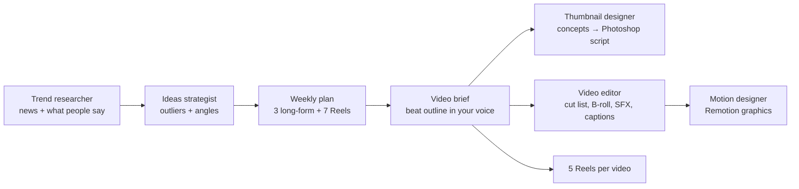

# Claude Content Team

**A whole YouTube and Instagram content team, built from Claude Code agents.** It finds what's working, plans the week, outlines videos in your voice, designs thumbnails (and builds them in Photoshop), plans edits for Premiere, and turns one long-form video into 5+ Reels.

Everything is plain text: agents and playbooks you can read, edit and make your own. Nothing expensive happens without your OK. Every thumbnail, edit and motion graphic starts with a one-screen plan, and work only starts after you say go.



## The team

| Agent | What it does |
|---|---|
| `trend-researcher` | Weekly AI and business briefing, fact-checks claims before they go into a script |
| `ideas-strategist` | Turns outlier videos and trends into long-form ideas, titles, hooks and Reels |
| `thumbnail-designer` | 3 concepts with and without a face, using colour theory, then builds the chosen one as a layered PSD via script |
| `video-editor` | Edit plan, cut list, B-roll and SFX cues, captions, chapters, Reels cut-downs |
| `motion-designer` | Animated text, stats and callouts in Remotion, rendered with transparency for Premiere |

## Commands

| Command | What happens |
|---|---|
| `/weekly-plan` | Research and outlier data → 3 long-form options + 7 Reels for the week. You pick one. |
| `/thumbnail` | 3 concepts × with face / without face → you pick → a layered Photoshop file built by script |
| `/face-retouch` | Makes your face thumbnail-quality: reshoot checklist, a non-destructive Photoshop script (Camera Raw, contrast, vibrance, less-yellow skin) and a manual pass for eyes, blemishes and rim light |
| `/edit-video` | Edit plan from your transcript → you approve → cut list, B-roll, SFX, captions, chapters, motion graphics, Reels |
| `/shorts-from-outlier <YouTube link>` | 5 Reels ideas, with hooks and scripts, from one long-form video |

Plain requests work too: "what's trending in AI this week?", "rate my thumbnail", "give me 5 Reels from this video". Claude picks the right specialist.

## Setup

1. **Get [Claude Code](https://claude.com/claude-code)** (terminal, desktop app or IDE).
2. **Clone this repo** and open a Claude Code session in the folder.
3. **Fill in `CLAUDE.md`** with your channel: positioning, pillars, audience, tone, how you film. This is the most important step, and every agent reads it.
4. **Fill in `voice/VOICE.md`** from real samples of how you talk (or ask Claude to build it from transcripts of your videos).
5. Optional extras:
   - **Skill packs:** see below.
   - **YouTube transcripts:** `python -m venv tools/.venv`, then `tools/.venv/Scripts/pip install mcp-youtube-transcript` (`tools/.venv/bin/pip` on Mac/Linux). `.mcp.json` points at it; approve the server the first time Claude asks. On Mac/Linux, change the command in `.mcp.json` to `tools/.venv/bin/mcp-youtube-transcript`.
   - **ffmpeg**, for checking footage and cutting Reels: `winget install Gyan.FFmpeg` (Windows) or `brew install ffmpeg` (Mac).
   - **Photoshop 2026** for thumbnails. Run the generated `.jsx` scripts with **File → Scripts → Browse…**.
   - **Outlier data:** `tools/outlier.mjs` talks to a local YouTube outlier finder. It's not included, and the team works without it.

### Skill packs (open source, MIT)

The team uses these as tools inside its own workflows. Install them into `.claude/skills/` (Git Bash on Windows, or any terminal on Mac/Linux):

```bash
mkdir -p vendor && cd vendor
git clone https://github.com/AgriciDaniel/claude-youtube
git clone https://github.com/Jakeschincariol/instagram-agent-skill
git clone https://github.com/coreyhaines31/marketingskills
git clone https://github.com/mvanhorn/last30days-skill
cd ..
cp -r vendor/claude-youtube/skills/claude-youtube .claude/skills/
cp -r vendor/instagram-agent-skill/skills/ig-* .claude/skills/
for s in copywriting copy-editing content-strategy social marketing-psychology; do cp -r vendor/marketingskills/skills/$s .claude/skills/; done
cp -r vendor/last30days-skill/skills/last30days .claude/skills/
```

Read each pack's code before you install it, as you would with anything else that runs on your machine.

## How it stays good
- **One brief rules everything.** `CLAUDE.md` overrides every agent and skill pack, so improving it improves everything.
- **Plan before spend.** Heavy work (thumbnail builds, edits, motion graphics) always starts with a one-screen plan and waits for your OK.
- **Adapt, never copy.** Other creators' outliers are evidence of demand. The team takes the angle or the format, never the title, layout or script.
- **Evidence or it's a guess.** Ideas cite the video or source they came from, and AI news is checked at the official source before it goes into a script.
- **Your voice, not AI voice.** Everything you'll say or post is written from `voice/VOICE.md`.

## Folder map
`CLAUDE.md` brief and rules · `.claude/agents/` the team · `.claude/skills/` the playbooks · `tools/` helper scripts · `projects/` one folder per video · `research/` weekly briefings · `inspiration/` outlier thumbnails · `voice/` your voice guide · `assets/premiere/` editing kit.

Your own projects, research, photos and voice samples are git-ignored, so they never end up in your fork.

## Credits
Skill packs by [AgriciDaniel](https://github.com/AgriciDaniel/claude-youtube), [Jakeschincariol](https://github.com/Jakeschincariol/instagram-agent-skill), [coreyhaines31](https://github.com/coreyhaines31/marketingskills) and [mvanhorn](https://github.com/mvanhorn/last30days-skill) (all MIT). Built with [Claude Code](https://claude.com/claude-code).

## License
[MIT](LICENSE): use it, fork it, make it yours.
